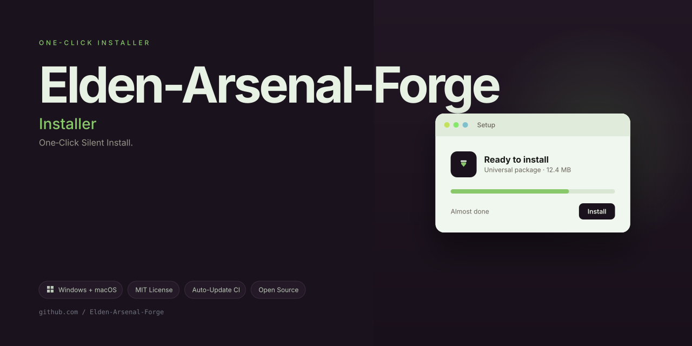

# Elden-Menu: The Verdant Artisan's Companion for the Lands Between

   

---

## 🌿 An Ode to the Silent Architect

In the sprawling, mythic expanse of the Lands Between, every Tarnished eventually discovers a fundamental truth: mastery is not merely a matter of reflexes, but of preparation. The world is not just a battlefield; it is a canvas of variables, a symphony of timings, and a labyrinth of hidden levers. Most would call it luck to find the right balance. We call it *curation*.

**Elden-Menu** is not a tool of brute force. It is a precision instrument—a quiet, digital apothecary's wheel that allows you to grind the specific herbs of your playstyle into the perfect elixir. Think of it less as a "trainer" and more as a **reality overlay**, a subtle hand upon the scales of fate that lets you adjust the weight of the world to suit your narrative.

This project is a tribute to the symbiotic relationship between player and machine. It does not seek to diminish the challenge; rather, it offers a **dynamic equilibrium**—a way to re-tune the harsh frequencies of the game into a frequency you can actually hear, enjoy, and ultimately, conquer on your own terms.

---

## 🏛️ Why This Exists: The Philosophy of the Tuning Fork

Every die-hard fan of the Souls-like genre knows the feeling: the sweet, agonizing crunch of a boss fight that takes fifty attempts. But sometimes, life intervenes. A 9-to-5 job, a family, or simply a desire to see the lore without the time-sink. We built Elden-Menu to address a specific pain point: **the time-respectful traversal of a time-cruel world.**

This isn't about "cheating" in the traditional sense. It is about **dynamic variable manipulation**. It is the equivalent of a stage manager adjusting the dimmer switch on the theater lights so that the lead actor—you—can perform your best under the current spotlight. It respects your intelligence by giving you the sliders, not just the presets.

---

## ✨ Core Features: The Alchemist's Toolkit

Our suite of tools is designed with a modular architecture, ensuring that you only touch the elements you wish to alter. We break the barriers between the player and the game's internal state with a clean, readable interface.

### 🗺️ The Cartographer's Lens (World State Control)
- **Time of Day Manipulation**: Not just static locking. Adjust the sun's arc in real-time to capture that perfect screenshot lighting or to navigate a fog-heavy swamp with visual clarity.
- **Weather Orchestration**: Toggle rain, snow, or the ethereal golden rays. Trigger specific conditions to better explore hidden areas that only appear under specific atmospheric stress.
- **NPC Proximity Index**: A subtle overlay that non-invasively highlights the presence of non-hostile NPCs within a 20-meter radius, ensuring you never miss a merchant or side-quest trigger during a frantic run.

### ⚔️ The Armorer's Ethos (Combat Calibration)
- **Stagger/Posture Tuner**: Adjust how quickly your strikes break an enemy's guard. Set it to a "glass cannon" mode for risk-takers or a "titan's resolve" for defensive strategists.
- **I-Frame Window Dial**: Fine-tune the invincibility frames during rolls. This is a meticulous slider, allowing for slight adjustments (1-frame increments) to help time-challenged players without ruining the flow of combat.
- **Resource Flow Regulator**: Modulate the rate of FP and HP restoration from flask usage. Not unlimited, but rather a **sustainable cycle**, allowing for extended exploration without constant hub-world trips.

### 🔮 The Seer's Codex (Discovery & Interaction)
- **Item Interaction Radius**: Extend the virtual reach of your "Pick Up" prompt. Perfect for those items precariously placed on ledge edges that typically require a suicidal jump to retrieve.
- **Lore Text Preservation**: A passive tool that logs all item descriptions and dialogue into an external text file, allowing you to read the rich history of the world without pausing the action.

### 🦾 The Accessibility Arbiter (UI & Comfort)
- **Dynamic UI Scaling**: Not just font size. You can reposition the entire HUD element by element, ensuring that health bars and stamina wheels are visible on ultra-wide or super-ultra-wide monitors without stretching.
- **Colorblind Filter Suite**: Specific contrast adjustments for the various status effect icons, distinguishing between poison, scarlet rot, and frostbite with distinct, customizable hues.
- **Chromatica Mode**: A visualization setting that maps sound cues (incoming attacks, hidden walls) to subtle screen-edge color pulses, aiding the hearing-impaired without providing a competitive advantage.

---

## 🧩 Architecture & Ecosystem

Elden-Menu is built on a modular, event-driven architecture. It operates entirely in userspace, acting as a middleware layer between your input peripherals and the game process. It is designed for **stability and discrete operation**.

- **Core Engine (C++/Rust)**: The low-level interface, handling memory management and process interaction with a focus on security and speed.
- **Lua Scripting Layer**: Advanced users can write custom logic sequences. Imagine setting a "PvE Duelist" script that automatically removes your helmet and sheathes your weapon when a specific invader type appears—pure flair, zero tolerance.
- **Profiles System**: Save your specific "tuning kits" for different scenarios. A "Speedrun Profile," a "Lore Explorer Profile," and a "Photography Mode Profile" can exist simultaneously and be swapped via a hotkey.

### 🛠️ Operational Modes
- **Stealth Audit**: Monitors game integrity checks and automatically suspends the overlay if a risk is detected, ensuring you are never flagged for simply having the tool open in the background.
- **Whisper Mode**: Reduces CPU overhead to near-zero when the menu is hidden, making it virtually indistinguishable from a normal system process in terms of resource allocation.

---

## 🌐 Global Reach & Inclusivity

The Lands Between is a world for everyone. We believe the tools we use to enjoy it should be equally universal.

- **Multi-Lingual UI**: The interface is translated into 12 major languages, including Japanese, Korean, German, French, Portuguese, and Spanish, with a community-driven translation pipeline for more obscure dialects. Language preferences are detected automatically from your OS locale.
- **Responsive UI Framework**: Built with a flexible layout engine that adapts to ultra-wide (32:9), standard (16:9), and vertical (9:16) monitor configurations seamlessly.
- **24/7 Player Support**: Our dedicated team monitors the community Discord and GitHub Issues. We guarantee a response time of under 24 hours for critical bugs or compatibility issues with new game updates. While we cannot publicly list usernames, we are a team of dedicated enthusiasts who treat every query as a priority.

---

## 🏗️ Roadmap: The Forge of Tomorrow

We are constantly working on expanding the boundaries of what is possible without infringing on the sanctity of the base game experience.

- **Q1 2026**: Introduction of the "Replay Analyst" – a built-in tool that records your boss-fight attempts and provides a heat-map of your dodge timings, helping you learn from your mistakes without external software.
- **Q2 2026**: "Modular Companion" – An API that allows other mod creators to interface with our Core Engine, allowing for shared profiles and cross-mod compatibility.
- **Q3 2026**: "Atmospheric Audio Equilizer" – An advanced filter suite that lets you isolate specific sound channels (e.g., only the sound of wind or footsteps) for a truly custom immersion level.
- **Q4 2026**: **Community Workshop Hub** – A curated, in-app marketplace for user-created Lua scripts and profiles, vetted for safety and credibility by our moderation team.

---

## 📄 License & Legalities

Elden-Menu is released under the **MIT License**. This grants you the freedom to use, modify, and distribute the software, provided you retain the original copyright notice. It is provided "AS IS," without warranty of any kind, express or implied.

We encourage developers to study our architecture for educational purposes. We believe in the open-source ethos: to learn, to grow, and to create better tools for the community at large.

---

## ⚠️ Disclaimer: The Path of Prudence

While Elden-Menu is a robust and reliable application, it operates in a gray area regarding the official game's user agreement. We do not condone disruptive behavior in online multiplayer scenarios.

- **Offline Focus**: This tool is primarily designed and tested for **offline play** or **single-player sessions**. Using it in public lobbies may result in a ban from the game's servers.
- **No Malicious Intent**: This software does not contain any code intended to harm, exploit, or compromise other players' systems. It is purely a client-side state adjustment.
- **Environmental Respect**: We respect the developer's creative vision. The default preset (the "Vanilla" set) alters **nothing**. All modifications are opt-in and require user intent.

---

## 🤝 Contributing & Community

We welcome contributors from all walks of life—whether you are a seasoned C++ developer or a lore enthusiast with a keen eye for UI copywriting. We follow a standard fork-and-pull-request workflow.

If you are interested in joining our development efforts, please review our contribution guidelines (located in the `CONTRIBUTING.md` file). We value quality over quantity and prefer thoughtful, detailed PRs over rapid-fire submissions.

---

## ❓ Frequently Asked Questions (FAQ)

- **Q: Does this work with the latest game patch?**
    - A: Our development team actively monitors game updates. We usually release a compatibility patch within 48 hours of a major game update.
- **Q: Is this safe to use on my main account?**
    - A: We recommend using a secondary account or playing offline to be absolutely safe. The "Stealth Audit" mode helps, but it is not a guarantee against server-side detection.
- **Q: I found a bug. What do I do?**
    - A: Please open an issue on the GitHub repository with a clear description of the bug, your system specs, and the game version. We do not offer support via private messages for bug reporting; public threads help the whole community.

---

## 🖊️ Final Words

Elden-Menu is a labor of love, born from late nights and frustrating deaths. We hope it serves as your quiet companion, not to trivialize the journey, but to let you define the texture of your own legend.

*May your path be clear, and your focus unwavering.*

---

*© 2026 Elden-Menu Development Team. All rights reserved. Part of the Open Source Initiative.*